

  

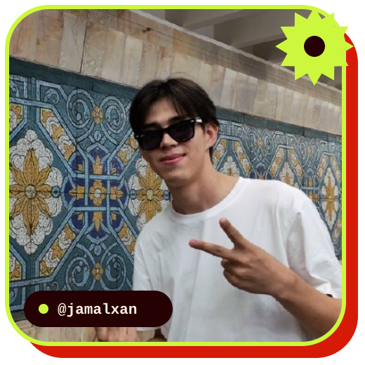

**Hi, I'm Jamolxon** 👋 Python backend developer and co-founder of <a href="https://promtchi.uz">Promtchi</a>. I build the systems a business runs on.

 

 
 

  

  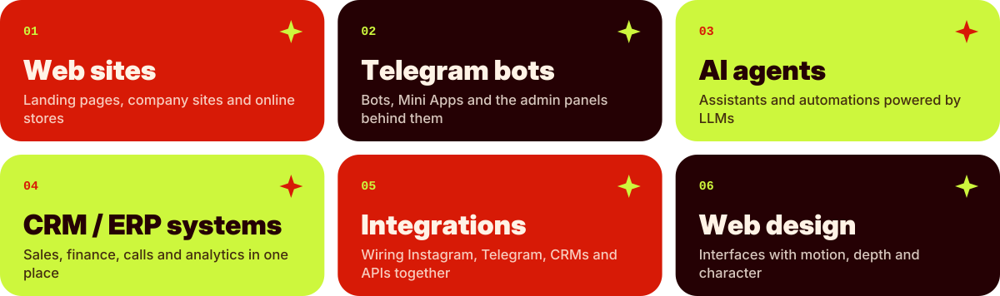

  

  <a href="https://vocably.uz">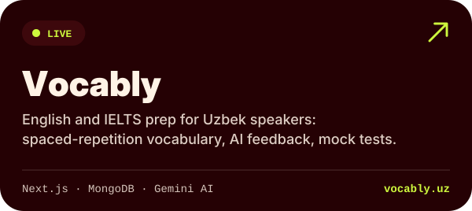</a>
  <a href="https://socialauto.uz">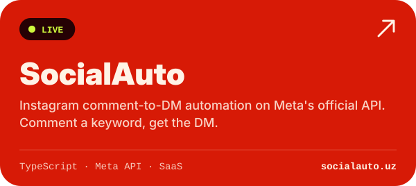</a>
  <a href="https://promtchi.uz">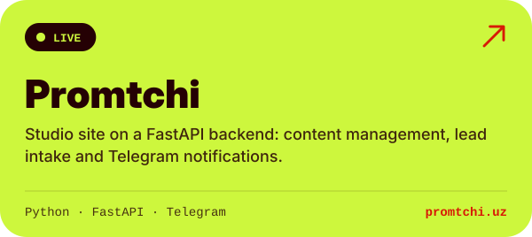</a>
  <a href="https://tizimly.uz">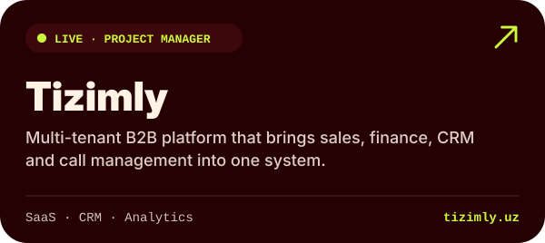</a>
  
  <a href="https://jamolxon.uz">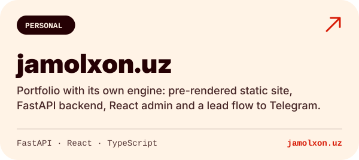</a>
  <a href="https://github.com/jamalxan/Everest-Mock">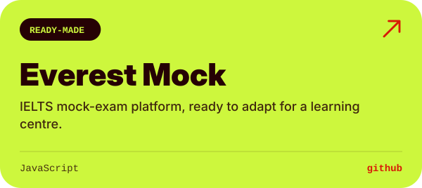</a>
  <a href="https://github.com/jamalxan/Online-Shop">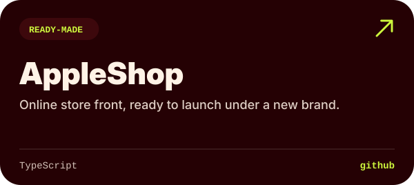</a>

  

  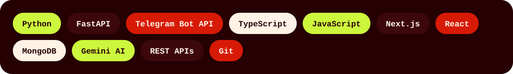

  

  <a href="https://t.me/jamalxon">Telegram</a> ·
  <a href="https://instagram.com/jamalxann">Instagram</a> ·
  <a href="https://youtube.com/@jamalxon">YouTube</a> ·
  <a href="https://jamolxon.uz">jamolxon.uz</a> ·
  <a href="https://promtchi.uz">promtchi.uz</a>

